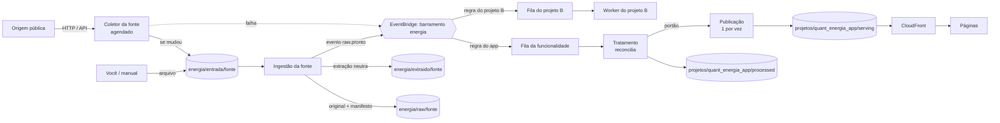

# Arquitetura na AWS: bucket compartilhado, raw único e projetos por prefixo

Desenho da fase AWS para um **bucket compartilhado com outras áreas**, onde a área de energia trabalha sob o prefixo
`energia/` e nele vão viver o quant-energia-app e, no futuro, outras rotinas (coleta de dados públicos, notificações,
outros produtos). Este documento é **proposta**, não implementação: o `ArmazenamentoS3` ainda não existe
(`core/src/qe_core/armazenamento.py`) e nada aqui está em produção. As decisões em aberto estão na seção 14, e a lista
de recursos para pedir ao time na seção 12.

Premissas que vêm do app e que o desenho preserva:
- as etapas só acessam dados por **chave** (`raw/…`, `processed/<funcionalidade>/…`, `serving/<funcionalidade>/…`)
  pelo `qe_core.armazenamento`; trocar local por S3 não muda o código das etapas;
- cada funcionalidade roda, testa e publica sozinha; falha numa não afeta as outras (`docs/nova_funcionalidade.md`);
- uma rodada publicada nunca é recalculada (registro das rodadas em `serving/`);
- os coletores já existem em `../energia-data-ingestion` (uma pasta por fonte, idempotentes, escrita atômica, layout
  `data/<partição>/arquivo` pensado para virar prefixo de bucket): a coleta na AWS parte deles.

## 1. Camadas e mapa de prefixos

```
s3://<bucket-compartilhado>/energia/
├── entrada/<fonte>/…                       landing: onde o coletor (ou você) deposita; o original é apagado após a ingestão
├── raw/<fonte>/…                           o ORIGINAL como veio da fonte; único para todos os projetos; imutável
├── extraido/<fonte>/…                      extração NEUTRA do raw (descompactar, mesmo conteúdo); compartilhada; reconstruível
├── comum/<tabela>/…                        opcional: derivado neutro de mais de um projeto (seção 10)
├── _estado/coletores/<fonte>.json          memória de cada coletor (última impressão, ETag, última chave)
└── projetos/
    ├── quant_energia_app/
    │   ├── processed/<funcionalidade>/…    forecast_bandeiras, risk_lab_dessem, pricing_descolamento
    │   ├── serving/<funcionalidade>/…      o que as páginas leem + registros de rodadas
    │   └── web/…                           páginas (HTML, JS, CSS)
    ├── notificacoes/…                      outros projetos: cada um no seu prefixo, mesma convenção
    └── <outro_projeto>/…
```

| Prefixo | Escreve | Lê | Reconstruível? |
|---|---|---|---|
| `entrada/` | coletor da fonte, ou você | ingestão da fonte | — (temporário) |
| `raw/<fonte>/` | **só a ingestão da fonte** | qualquer projeto, só leitura | **não**: é a cópia de segurança |
| `extraido/<fonte>/` | a ingestão da fonte | qualquer projeto, só leitura | sim, do raw |
| `comum/` | o dono de cada tabela | projetos que a declararem | sim, do raw |
| `_estado/` | o coletor da fonte | o coletor | sim (perde só a economia de downloads) |
| `projetos/<p>/processed/` | workers do projeto `<p>` | só o projeto `<p>` | sim, do raw |
| `projetos/<p>/serving/` | worker de publicação do projeto | CloudFront; o projeto | **registros de rodadas não** |
| `projetos/<p>/web/` | deploy do projeto | CloudFront | sim, do git |

Regras:
- `raw/` fica fora de `projetos/`: não pertence a ninguém, é o contrato entre quem coleta e quem consome. **Nele só
  entra o original, sem nenhuma alteração.** Quem precisa de outro arquivo do mesmo zip, ou testa uma ideia nova, lê o
  raw: nunca é preciso baixar de novo.
- `extraido/` existe para ninguém repetir a extração: o zip do DESSEM é aberto uma vez, pela ingestão, e todos os
  projetos leem os arquivos soltos. Só existe para fontes que chegam em contêiner (zip) ou que valem ser guardadas
  descompactadas; um CSV ou um PDF é lido direto do raw. O catálogo da seção 5.5 diz, por fonte, onde ler.
- Um projeto nunca lê o `processed/` ou o `serving/` de outro. Se dois projetos precisam do mesmo derivado, ele sobe
  para `comum/` com dono definido (seção 10); não se copia entre projetos.

## 2. Convenções de nome

### 2.1 Fonte
`<emissor>_<conjunto>`, minúsculas, sem acento, com `_`: `ccee_dessem`, `ccee_pld_horario`, `ons_balanco_dessem`,
`tempook_ena`. É o nome da pasta em `entrada/`, `raw/` e `extraido/`, e o nome do coletor (a pasta do repositório de
coleta, com `-` trocado por `_`). Esse nome é a **interface** entre quem coleta e quem consome; mudar é decisão
compartilhada. Uma fonte, um dono (quem escreve nela).

### 2.2 Chave no raw
```
raw/<fonte>[/<partição>]/v=<sha8>/<nome_original>
raw/<fonte>[/<partição>]/v=<sha8>/<nome_original>.coleta.json      manifesto ao lado do arquivo
```
- **`<partição>`**: pelo **período de referência do dado** (o mês do deck, o dia do caso), não pela data da coleta, no
  formato `chave=valor` (compatível com Athena): `ano=2026`, `mes=2026-10`, `dia=2026-10-15`, `deck=2026-10`,
  `emissao=2026-10-15`. Fonte sem período natural (um histórico que muda no lugar) fica sem partição.
- **`v=<sha8>`**: os 8 primeiros caracteres do SHA-256 do conteúdo original. Mesmo conteúdo, mesma chave: gravar de novo
  é um **não-evento**. Conteúdo diferente com o mesmo nome (republicação, arquivo que cresce, histórico atualizado)
  vira **uma versão nova ao lado da anterior**, nunca sobrescreve. A versão vigente é a de maior `coletado_em` no
  manifesto (a mesma regra que o app usa hoje para os decks).
- **`<nome_original>`**: o nome que a fonte deu, sem renomear.

### 2.3 Manifesto (`<arquivo>.coleta.json`)
Escrito pela ingestão, ao lado do arquivo, depois de conferir a releitura:
```json
{
  "fonte": "ccee_dessem",
  "particao": {"mes": "2026-10"},
  "nome_original": "DES_202610.zip",
  "sha256": "…",
  "tamanho": 183422913,
  "origem": {"tipo": "coletor", "url": "https://…", "http": 200, "etag": "…", "last_modified": "…"},
  "coletado_em": "2026-10-15T21:05:12Z",
  "coletor": {"nome": "energia-coletor-ccee-dessem", "versao": "1.4.0"},
  "impressao": "…",
  "anterior": "raw/ccee_dessem/mes=2026-10/v=ab12cd34/DES_202610.zip"
}
```
`origem.tipo` é `coletor` ou `manual` (arquivo solto por você em `entrada/`). `impressao` só existe nas fontes em que
ela difere do hash do conteúdo (seção 5.2).

### 2.4 Extraído
`extraido/<fonte>/<partição>/<arquivo>[.gz]`, com o mesmo conteúdo do arquivo dentro do original (o hash do conteúdo
descomprimido é conferido, como hoje) e um `_extracao.json` com a chave do raw de onde veio e o hash dos arquivos.
É o que o app guarda hoje em `data/raw/ccee_dessem/dia=…/*.gz`.

### 2.5 Recursos AWS
`energia-<papel>-<alvo>-<ambiente>`: `energia-coletor-ccee-pld-horario-prod`, `energia-ingestao-ccee-dessem-prod`,
`energia-tratar-risk-lab-dessem-prod`, `energia-publicar-pricing-descolamento-prod`. Filas: sufixo `-fila` e `-dlq`.
Barramento de eventos: `energia`. Tags obrigatórias: `area=energia`, `projeto=<projeto ou plataforma>`,
`componente=<coletor|ingestao|tratar|publicar|web>`, `ambiente=<dev|prod>`.

## 3. Mapeamento das chaves do código para o S3

O código continua pedindo `raw/…`, `extraido/…`, `processed/…`, `serving/…`. O `ArmazenamentoS3` traduz por
configuração:

| Chave do código | Chave no bucket |
|---|---|
| `raw/<fonte>/…`, `extraido/<fonte>/…` | `energia/raw/<fonte>/…`, `energia/extraido/<fonte>/…` |
| `processed/<funcionalidade>/…` | `energia/projetos/quant_energia_app/processed/<funcionalidade>/…` |
| `serving/<funcionalidade>/…` | `energia/projetos/quant_energia_app/serving/<funcionalidade>/…` |

Configuração nova (hoje só existe `QE_BUCKET`): `QE_BUCKET`, `QE_PREFIXO_COMPARTILHADO` (`energia`) e
`QE_PREFIXO_PROJETO` (`energia/projetos/quant_energia_app`). Mudar nome de prefixo ou de projeto muda a configuração,
não as etapas. O armazenamento local imita o bucket sem esses prefixos (a árvore de `data/`).

**Mudança no código do app que esta decisão traz (fases 0 e 1):** hoje `raw/` guarda o que o app extrai dos zips
(`PDO_SIST.DAT.gz`, `sistema.dat`…). Isso passa a ser `extraido/`, e `raw/` passa a ter o original. Concretamente: as
constantes de `qe_core.fontes` (`RAW_DESSEM`, `RAW_NEWAVE`…) apontam para `extraido/` onde o conteúdo é extraído; a
ingestão passa a gravar também o original em `raw/` com o manifesto; `data/raw/` local (que hoje é o extraído)
renomeia para `data/extraido/`. Os zips originais, que o app apaga da entrada, já existem em `energia-data-ingestion`
e entram no raw na carga inicial.

## 4. Quem faz o quê: quatro papéis

| Papel | Escopo | O que faz | Escreve em |
|---|---|---|---|
| **Coletor** | **por fonte** | busca na origem, decide se mudou, deposita | `entrada/<fonte>/`, `_estado/` |
| **Ingestão** | **por fonte** (compartilhada) | valida, grava o original no raw com manifesto, extrai, emite o evento | `raw/<fonte>/`, `extraido/<fonte>/` |
| **Tratamento** | **por funcionalidade** | raw/extraído → tabelas da funcionalidade (incremental, idempotente) | `projetos/<p>/processed/<f>/` |
| **Publicação** | **por funcionalidade** | processed → serving; registra a rodada | `projetos/<p>/serving/<f>/` |

Por que o tratamento **não** é um worker único que serve vários projetos:
- O processed de um projeto é a *interpretação* dele do dado bruto (o que guardar, em que granularidade, com que
  definições do modelo). Um worker comum teria de conhecer a regra de cada projeto: acoplamento, e uma mudança de um
  projeto exigiria deploy do outro.
- Permissão: um worker comum precisaria de escrita em todos os prefixos de projeto. Com um por funcionalidade, a role
  escreve só no próprio prefixo (privilégio mínimo).
- Falha e custo ficam isolados: o tratamento do DESSEM de um projeto não atrasa nem derruba o de outro.
- O que é *compartilhável* é o **código**, não o worker: os leitores (`qe_core.leitores`) já são uma biblioteca comum.

Por que a ingestão **é** por fonte e não por projeto: duas ingestões gravando o mesmo arquivo, ou disputando o mesmo
original (a caixa de entrada o apaga), é o problema que levou ao `qe_core.fontes`. Na AWS vira um worker por fonte, dono
da escrita naquela fonte.

Por que coletor e ingestão são papéis **separados**: o coletor só sabe falar com a origem (HTTP, API, token, limite de
taxa) e decidir se há algo novo; a ingestão tem um caminho único para qualquer origem (coletor ou arquivo solto por
você): validar, gravar o original, extrair, emitir o evento. Assim o raw tem **um** ponto de escrita, um manifesto
uniforme e um ponto de emissão de evento, qualquer que seja a fonte.

Por que tratamento e publicação **não** ficam no mesmo worker:
- O tratamento é automático, reconstruível e roda a cada dado novo. A publicação cria um **registro** (a rodada) que não
  se recalcula; nas bandeiras é um ato deliberado (`publicar --motivo`), e `atualizar` para antes dela de propósito.
- Isolar a publicação permite portão: automática (Risk Lab: rodada por insumo novo), com aprovação (bandeiras) ou manual.
- Escrever o registro precisa de serialização (seção 9); fica mais simples num worker só dele.

Implantação: a mesma imagem de contêiner (`qe`) com comandos diferentes (`qe <funcionalidade> tratar`, `… publicar`).
O isolamento está na **role, na fila e na regra de evento** de cada funcionalidade, não em bases de código separadas.

## 5. Coletores (web scraping e downloads)

### 5.1 O que um coletor faz e não faz
- **Faz:** buscar na origem (arquivo, página, API), decidir **se há algo novo**, depositar o original em
  `entrada/<fonte>/` e atualizar o próprio estado.
- **Não faz:** interpretar o conteúdo. Montar tabela, converter formato, limpar: isso é tratamento (de um projeto) ou,
  se for neutro, `comum/`. **O que o coletor entrega é sempre o conteúdo original, byte a byte.** Qualquer
  processamento no coletor serve só para decidir *se mudou* ou *o que baixar*, e nunca altera o que vai para o raw.

### 5.2 Quatro tipos de fonte, quatro formas de detectar mudança

| Tipo | Exemplo (hoje) | Como detecta |
|---|---|---|
| **1. Arquivo novo e imutável na origem** | decks mensais da CCEE (`NW202610.zip`, `DES_202610.zip`, `DC202610.zip`), `ons-balanco-dessem` (parquet por dia) | Compara o catálogo da origem com o que já existe (nome, data de publicação, tamanho exato: os coletores atuais já fazem checagem por tamanho). Baixa só o que falta |
| **2. Arquivo que muda no lugar** | CSV anual do PLD horário (`ccee-pld-horario`) e médias, histórico de bandeiras da ANEEL | Consulta condicional (`ETag`/`If-Modified-Since`/tamanho) sem baixar; se mudou, baixa e compara o hash; hash novo = versão nova (`v=`) |
| **3. Página ou API sem arquivo estável** | HTML de portal, JSON de API sem versão | Baixa, extrai a **parte relevante**, normaliza (ignora hora, contador, token) e calcula a **impressão**; compara com a última guardada em `_estado/`. Se mudou, grava o **original inteiro** (corpo e cabeçalhos da resposta); o raw nunca recebe a versão normalizada |
| **4. Com autenticação ou cota** | `tempook-ena` (token) | Como o tipo 1 ou 2, com segredo no Secrets Manager e controle de taxa |

Fonte que não precisa de processamento nenhum ("só pega e envia") é o tipo 1 ou 2 sem lógica própria: nenhuma
normalização, só comparar e depositar. A impressão só existe no tipo 3 (nos demais, é o hash do conteúdo).

### 5.3 Regras comuns
- **Idempotente:** rodar de novo não duplica nada. Mesmo conteúdo, mesma chave `v=`: a ingestão grava de forma
  condicional (criar só se não existe) e trata "já existe" como "nada novo".
- **Escrita atômica:** o coletor grava em `<nome>.part` e renomeia; a ingestão só reage ao nome final. Coleta com
  vários arquivos deposita uma pasta com um arquivo `_pronto` por último, e a ingestão só age sobre o conjunto completo.
- **Uma execução por vez** por coletor (concorrência reservada 1), mais escrita condicional do `_estado/` (ETag).
- **Educado com a fonte:** `User-Agent` identificável, limite de taxa, retentativas com recuo, respeito a robots/termos
  de uso. Falha parcial (alguns arquivos) não perde o que já foi baixado.
- **Segredos** em Secrets Manager, nunca em configuração versionada (como o `TEMPOOK_API_TOKEN` já é por variável).
- **Sem mudança não gera dado:** execução sem novidade só registra log e atualiza `_estado/` (última execução).
- **Falha é evento:** o coletor que falha depois das retentativas emite `coleta.falhou` (seção 6) e cai na fila de mensagens
  mortas; alarme avisa.

### 5.4 Estrutura de um coletor
Cada coletor implementa duas funções; o resto é comum:

```python
def listar() -> list[Item]:
    """O que a origem oferece agora: nome, partição, URL, tamanho/ETag (sem baixar o conteúdo, quando possível)."""

def impressao(item, conteudo) -> str | None:
    """Só no tipo 3: parte relevante normalizada. Nos demais, None (vale o hash do conteúdo)."""
```

**Contrato obrigatório, biblioteca opcional.** O que **precisa** ser igual em todo coletor é o contrato: o formato da
chave no raw (seção 2.2), o manifesto (2.3), o arquivo de estado e o evento (seção 6). Um coletor que o cumpra funciona
com ou sem biblioteca, em qualquer linguagem ou ambiente (Lambda comum, Fargate com navegador).

**Recomendação: uma biblioteca pequena (`energia_coleta`) para o que é transversal** (cabeçalho HTTP com recuo,
comparação com `_estado/`, escrita atômica em `entrada/`, atualização do estado, métrica e log estruturado). Isso
difere da convenção atual do repositório de coleta ("sem código compartilhado, redundância proposital"): com dez ou
mais Lambdas, copiar a parte transversal faz os erros divergirem, e são os erros que não aparecem (uma escrita que
deixa arquivo pela metade, um estado que não é atualizado). O que é **específico da fonte** continua independente: uma
pasta por coletor, `listar()` e `impressao()` próprios, deploy próprio.

Por que isso **não** tira a independência dos coletores:
- **Em execução nada é compartilhado.** Cada coletor é uma Lambda com agendamento, estado, role, fila de erros e
  concorrência próprios. A **frequência está no agendamento** (uma regra do Scheduler por fonte), não no código: um
  coletor a cada 15 minutos e outro alguns dias por mês só diferem na regra. Nenhum enxerga o outro.
- **A biblioteca só existe na construção.** Cada coletor a empacota **dentro da própria imagem, com versão fixa**
  (`energia_coleta==X.Y`). Não é camada compartilhada que atualiza sozinha: um coletor que fica meses sem rodar
  continua com a versão com que foi construído, e cada um atualiza no seu ritmo.
- **O custo real** é de versionamento: um defeito na biblioteca chega a quem atualizar para a versão com defeito, e
  versões diferentes ficam em uso ao mesmo tempo. Mitigação: biblioteca pequena, mudança compatível por padrão e um
  teste de contrato que todo coletor roda na integração contínua.

Frequências diferentes:
- **Publicação irregular** (alguns dias por mês): não tentar adivinhar o dia; rodar com mais frequência e deixar a
  checagem barata (consulta ao índice ou `HEAD`, menos de um segundo, sem novidade encerra com uma linha de log).
  Lambda só cobra o que roda.
- **Coletor muito frequente:** o intervalo deve ser maior que a duração esperada; a concorrência reservada 1 impede duas
  execuções ao mesmo tempo (a seguinte espera ou é reprogramada).

Decisão na seção 14.4.

### 5.5 Catálogo inicial de fontes
Ponto de partida (a confirmar com o conteúdo real de cada coletor):

| Fonte (raw) | Coletor atual | Tipo | Cadência sugerida | Lê-se de |
|---|---|---|---|---|
| `ccee_newave` | `ccee-newave` | 1 | diária (deck mensal, republicações) | `extraido/` (conjuntos do app) |
| `ccee_dessem` | `ccee-dessem` | 1 | diária (o zip mensal cresce; ver 14.3) | `extraido/` (arquivos do dia) |
| `ccee_decomp` | `ccee-decomp` | 1 | diária/semanal | `extraido/` |
| `ccee_pld_horario` | `ccee-pld-horario` | 2 | diária | `raw/` (CSV) |
| `ccee_pld_media_{diaria,semanal,mensal}` | `ccee-pld-media-*` | 2 | diária | `raw/` (CSV) |
| `ons_balanco_dessem` | `ons-balanco-dessem` | 1 (cópia de S3 público) | diária | `raw/` (parquet) |
| `tempook_ena` | `tempook-ena` | 4 | por emissão | `raw/` (a confirmar se é a mesma fonte do app, hoje `ecmwf`) |
| `ccee_newave_resultado` | `ccee-newave-resultado` | 1 | mensal | fora do escopo atual do app |
| `ccee_limites_pld`, `ccee_patamares`, `ons_pmo`, `ccee_infobandeira`, `aneel_bandeiras` | (manuais) | `origem.tipo = manual` hoje; candidatos a coletor | — | `raw/` |

Divergência de nome a resolver: o coletor `ccee-pld-horario` corresponde ao `ccee_pld` do app. Na AWS a fonte é
`ccee_pld_horario`; o app a lê por configuração do mapeamento, sem mudar as etapas.

## 6. Fluxo e gatilhos



**Fan-out é do barramento, não da ingestão.** A ingestão publica um evento e não sabe quem consome. Cada projeto tem a
**sua regra** no EventBridge, filtrando as fontes que usa, com destino na **sua fila**. Um deck do NEWAVE chega uma vez
e dispara quantas regras houver: uma para o app (as funcionalidades que usam NEWAVE), outra para cada projeto
interessado. Acrescentar um consumidor é criar uma regra; nada muda na ingestão nem nos outros.

Evento (barramento `energia`):
```json
{
  "source": "energia.ingestao",
  "detail-type": "raw.pronto",
  "detail": {
    "fonte": "ccee_dessem",
    "particao": {"dia": "2026-10-15"},
    "raw": "raw/ccee_dessem/mes=2026-10/v=ab12cd34/DES_202610.zip",
    "extraido": "extraido/ccee_dessem/dia=2026-10-15/",
    "sha256": "…",
    "origem": "coletor",
    "novo": true
  }
}
```
Outros eventos: `coleta.falhou` (`source: energia.coletor`), e, para o futuro, `publicacao.feita`.

Refinamentos em relação ao "caiu um objeto no raw, dispara o worker":

1. **O evento é o fim da ingestão, não cada objeto.** Um deck é um *conjunto*: o NEWAVE tem dois conjuntos por deck; o
   dia do DESSEM chega em duas metades (entrada e resultado) que podem vir separadas. Disparar a cada `PutObject`
   chamaria o worker com o conjunto incompleto, várias vezes. A ingestão emite o evento só depois de gravar e conferir.
   Em `entrada/`, o gatilho é um objeto por coleta (ou o `_pronto` de uma pasta), porque ali o conjunto é fechado pelo
   coletor.
2. **O worker reconcilia, não obedece ao evento.** O `tratar` de hoje já compara o que há em raw/extraído com o que
   foi tratado e refaz o que mudou. Na AWS o evento só *acorda* essa conta. Assim evento duplicado (entrega ao menos
   uma vez), perdido ou fora de ordem não corrompe nada, e uma execução agendada (por exemplo diária) serve de rede de
   segurança.
3. **Fila por projeto entre o evento e o worker.** Uma recarga histórica (70 decks do DESSEM) gera centenas de eventos de
   uma vez. A fila (SQS) absorve, agrupa numa janela e limita a concorrência (uma execução de tratamento por
   funcionalidade por vez), com fila de mensagens mortas e alarme.

Fluxo da publicação: o tratamento, ao terminar, aciona o portão da funcionalidade. Bandeiras: gera a prévia e espera
aprovação. Risk Lab: publica sozinho, e o registro só ganha rodada se os insumos mudaram (já é a regra do app).

## 7. Armazenamento: o que é do bucket e o que é do prefixo

Em bucket compartilhado, **versionamento, Object Lock e criptografia padrão são do bucket inteiro**; permissões (IAM),
regras de ciclo de vida, gatilhos de evento e a origem do CloudFront funcionam **por prefixo**.

| Necessidade | Como fica |
|---|---|
| Raw imutável | Chave com `v=<sha8>` (conteúdo igual = mesma chave) e **gravação condicional** (criar só se a chave não existe); negar `DeleteObject` e sobrescrita em `energia/raw/` para todas as roles, menos a de administração. Versionamento do bucket, se o dono ligar, é reforço |
| Raw como cópia de segurança | Resolve a pendência de `data/raw/` ficar só na máquina local |
| Custo do raw | O original custa pouco: ordem de grandeza de 11 GB de zips do DESSEM é centavos de dólar por mês no armazenamento padrão. Ciclo de vida para classes mais baratas depois de meses |
| Versões antigas do processed | Se o bucket é versionado, regra por prefixo que expira versões não correntes em `processed/` e `extraido/` |
| Registro de rodadas | `serving/…/historico_*.json` precisa de versionamento (ou escrita condicional por ETag) |
| Entrada | Regra que expira objetos em `entrada/` após alguns dias (a ingestão apaga o original) |
| `_estado/` | Pequeno; sem ciclo de vida |

## 8. Permissões

Uma role por worker, escopo por prefixo:

| Role | Leitura | Escrita |
|---|---|---|
| coletor de `<fonte>` | `_estado/coletores/<fonte>.json`, segredo da fonte | `entrada/<fonte>/`, `_estado/coletores/<fonte>.json` |
| ingestão de `<fonte>` | `entrada/<fonte>/` | `raw/<fonte>/`, `extraido/<fonte>/`, evento no barramento |
| tratamento de `<p>/<f>` | `raw/` e `extraido/` das fontes que a funcionalidade usa | `projetos/<p>/processed/<f>/` |
| publicação de `<p>/<f>` | `projetos/<p>/processed/<f>/` | `projetos/<p>/serving/<f>/` |
| CloudFront (OAC) | `projetos/<p>/serving/`, `projetos/<p>/web/` | — |

Nenhuma role de projeto escreve em `raw/` ou `extraido/`. Nenhuma lê o prefixo de outro projeto.

## 9. Publicação e entrega

- **Registro de rodadas:** é um arquivo único lido e regravado; duas publicações simultâneas perdem uma atualização.
  Solução: fila de publicação com concorrência 1 por funcionalidade, mais escrita condicional (ETag) como segunda
  trava. As rodadas publicadas continuam imutáveis.
- **CloudFront:** uma distribuição por projeto, com duas origens no mesmo bucket e caminhos de origem por prefixo:
  `/dados/*` → `energia/projetos/<p>/serving/` e `/*` → `energia/projetos/<p>/web/`. As páginas continuam buscando
  `/dados/<funcionalidade>/x.json`; as URLs não mudam e não há CORS (mesma origem).
- **Licenças:** dados de terceiros (curvas Dcide, ECMWF) ficam em `raw/` e `extraido/`, privados; as páginas só mostram
  resultado derivado (como já diz o README).

## 10. O que mais de um projeto precisa: `comum/`

Se dois projetos precisarem do mesmo derivado (hoje o Risk Lab e o descolamento tratam o PLD horário cada um por conta),
há três caminhos, em ordem de preferência:

1. **Deixar duplicado**, compartilhando só o leitor (biblioteca). Estado atual; barato enquanto o volume é pequeno.
2. **`comum/<tabela>/`** com dono e contrato (esquema, definições, atualização). Só para tabela **neutra**, sem
   interpretação do modelo de nenhum projeto (por exemplo, PLD horário publicado em formato largo). Quem a produz é um
   worker próprio, com evento próprio; os consumidores a tratam como fonte.
3. Um projeto ler o `processed/` do outro: **não**. Cria acoplamento de esquema e de prazo.

A diferença para `extraido/`: o extraído é só descompactar (mesmo conteúdo), sem decisão de ninguém; `comum/` já é uma
tabela com esquema. Só criar `comum/` quando existir o segundo consumidor real.

## 11. Computação

| Carga | Tamanho hoje | Onde roda |
|---|---|---|
| Coletor | segundos a poucos minutos (download dos zips grandes por streaming) | Lambda (imagem de contêiner); Fargate se a fonte pedir navegador (JavaScript) ou passar do limite |
| Ingestão de um dia ou de um deck | segundos | Lambda (imagem de contêiner) |
| Tratamento incremental (um mês do DESSEM) | segundos a poucos minutos | Lambda, se couber nos limites (15 min, memória, disco temporário) |
| `tratar --refazer`, recarga histórica, backtests longos | minutos em vários processos | Fargate (mesma imagem) |
| Publicação | segundos | Lambda |

A mesma imagem roda nos dois lugares; o gatilho decide. Orquestração (Step Functions) só se a cadeia crescer; hoje cada
etapa é uma função com fila e não precisa dela.

## 12. Recursos a solicitar ao time (ponto de partida)

Lista semiestruturada para abrir pedidos. Tamanhos são **chute inicial para calibrar**, não medida. `<amb>` = dev ou
prod; `<fonte>` e `<f>` seguem as convenções da seção 2.

### 12.1 Plataforma (uma vez)

| # | Recurso | Pedido |
|---|---|---|
| P1 | Bucket compartilhado | Confirmar: versionamento, Object Lock, criptografia (KMS) e quem gerencia o ciclo de vida. Pedir **prefixo `energia/`** com políticas próprias; notificação para EventBridge ligada |
| P2 | Chave KMS | `alias/energia` (ou a padrão do bucket), com uso liberado às roles abaixo |
| P3 | Barramento EventBridge | `energia` (regras de `raw.pronto`, `coleta.falhou`) |
| P4 | Repositórios de imagem (ECR) | `energia/qe` (app), `energia/ingestao`, `energia/coleta-<fonte>` (ou uma imagem de coleta com comando por fonte) |
| P5 | Segredos | Secrets Manager: `energia/<fonte>/token` por fonte que exigir |
| P6 | Alertas | Tópico SNS `energia-alertas` + alarmes (fila de mensagens mortas não vazia, coletor sem sucesso há N dias) |
| P7 | CloudFront + OAC + certificado | Uma distribuição por projeto (`quant-energia-app`), origens por prefixo (seção 9) |
| P8 | Ciclo de vida por prefixo | `entrada/` expira em dias; `raw/` e `extraido/` para classes mais baratas após meses; versões não correntes de `processed/` expiram |
| P9 | Política do bucket | Negar sobrescrita e exclusão em `energia/raw/` (menos administração); escopo por prefixo para as roles |
| P10 | Rede | Lambdas fora de VPC (acesso à internet) ou VPC com saída (NAT) e, se alguma fonte exigir, IP fixo de saída |

### 12.2 Por fonte (repetir para cada fonte do catálogo da seção 5.5)

| # | Recurso | Nome | Gatilho | Tamanho inicial | Concorrência / retentativa | Role |
|---|---|---|---|---|---|---|
| F1 | Agendamento | `energia-agenda-<fonte>-<amb>` | EventBridge Scheduler (`cron` da fonte) | — | — | invoca F2 |
| F2 | Lambda coletor | `energia-coletor-<fonte>-<amb>` | F1 | 1 GB; 15 min; disco temporário 2–10 GB | reservada 1; 2 retentativas; DLQ | seção 8 |
| F3 | Fila + DLQ da ingestão | `energia-ingestao-<fonte>-fila` / `-dlq` | regra: `Object Created` em `entrada/<fonte>/` (padrão por prefixo) | — | visibilidade ≥ 6× o timeout | — |
| F4 | Lambda ingestão | `energia-ingestao-<fonte>-<amb>` | F3 (lote 1) | 3 GB; 15 min; disco 10 GB | reservada 1 a 2; DLQ | seção 8 |
| F5 | Estado | `energia/_estado/coletores/<fonte>.json` | — | — | escrita condicional | coletor |

### 12.3 Por funcionalidade de projeto (o app começa com três)

Funcionalidades: `forecast_bandeiras`, `risk_lab_dessem`, `pricing_descolamento`.

| # | Recurso | Nome | Gatilho | Tamanho inicial | Concorrência / retentativa | Role |
|---|---|---|---|---|---|---|
| A1 | Regra de evento | `energia-tratar-<p>-<f>-regra` | `raw.pronto` das fontes da funcionalidade (filtro em `detail.fonte`) | — | — | envia à A2 |
| A2 | Fila + DLQ | `energia-tratar-<p>-<f>-fila` / `-dlq` | A1 (janela de lote 60 s) | — | — | — |
| A3 | Lambda tratamento | `energia-tratar-<p>-<f>-<amb>` | A2 | 3 a 10 GB; 15 min; disco 10 GB | reservada 1; DLQ | seção 8 |
| A4 | Tarefa Fargate (pesado) | `energia-tratar-<p>-<f>-pesado-<amb>` | manual / agendada | 4 vCPU, 16 GB | 1 | mesma da A3 |
| A5 | Agenda de segurança | `energia-reconcilia-<p>-<f>-<amb>` | Scheduler diário | — | — | invoca A3 |
| A6 | Fila FIFO de publicação | `energia-publicar-<p>-<f>-fila.fifo` | fim do tratamento (portão aberto) ou manual | — | grupo = funcionalidade | — |
| A7 | Lambda publicação | `energia-publicar-<p>-<f>-<amb>` | A6 | 1 a 2 GB; 5 min | reservada 1; DLQ | seção 8 |

### 12.4 Roles (mínimo)
Uma por Lambda ou tarefa, seguindo a tabela da seção 8, mais a de administração do raw. Nenhuma role de projeto tem
escrita em `raw/` ou `extraido/`.

### 12.5 Informações que o time precisa confirmar antes
Conta e região do bucket e dos workers; se o EventBridge e o bucket ficam na mesma conta; quem aprova mudança no ciclo
de vida do bucket; convenção de nomes e tags da empresa; exigência de VPC para saída de internet; observabilidade padrão
(CloudWatch, outra ferramenta).

## 13. Como crescer sem retrabalho

- **Fonte nova** (outro coletor): uma pasta de coletor + F1 a F5 + linha no catálogo. Nenhum projeto existente é tocado.
- **Funcionalidade nova no app:** um prefixo em `processed/` e `serving/`, A1 a A7 e a role. O código segue
  `docs/nova_funcionalidade.md`.
- **Projeto novo (por exemplo, notificações):** `projetos/<novo>/`, suas regras de evento e roles. Um projeto que só
  reage a eventos (notificar quando sai um deck) assina `raw.pronto` e `coleta.falhou` e não precisa de processed.
- **Fonte lida por mais de um projeto:** nada a fazer na ingestão; cada projeto cria a sua regra.
- **Dado de um projeto que outro precisa:** vira `comum/` com dono, ou o projeto o publica como fonte (seção 10).

## 14. Críticas ao desenho e decisões em aberto

Pontos em que o desenho tem custo e vale discordar:

1. **Bucket compartilhado** acopla o que é do bucket (versionamento, Object Lock, criptografia, notificações, *uma única
   configuração de ciclo de vida*). Duas equipes que gerenciam o ciclo de vida por infraestrutura como código podem
   sobrescrever as regras uma da outra. Atribuir custo por projeto também é mais difícil (o S3 só separa por prefixo com
   métricas adicionais). Um bucket da área de energia, ou no mínimo uma única fonte de verdade da configuração do
   bucket, evitaria isso. O desenho acima funciona nos dois casos.
2. **Raw com o original completo (decidido).** Reaproveitável por outras funcionalidades e testes sem baixar de novo, e
   guarda o que a fonte pode retirar do ar depois. Custa uma mudança de convenção no app (`raw/` vira original,
   `extraido/` assume o papel atual) e uma ingestão que grava as duas camadas; está descrita na seção 3.
3. **Arquivo que cresce na origem.** O zip mensal do DESSEM cresce ao longo do mês; baixar o mensal todo dia gera uma
   versão nova (`v=`) por dia, cada uma com centenas de MB. É barato, mas desnecessário: o coletor deve preferir as
   partes imutáveis (os zips diários dentro do mensal, que a ingestão já sabe ler) e baixar o mensal só no fechamento.
   Definir por fonte.
4. **Coletor com código compartilhado ou não (recomendação: biblioteca pequena e opcional).** O repositório de coleta
   tem como princípio "sem código compartilhado". A recomendação é manter o **contrato** como obrigatório e oferecer uma
   biblioteca só para o transversal, empacotada com versão fixa em cada coletor (seção 5.4). Se a preferência for
   manter a regra atual, o custo é repetir esse código em cada coletor e aceitar que ele evolua de forma diferente; o
   contrato continua sendo o que garante que as fontes se comportem igual.
5. **Onde mora o código da ingestão.** Hoje é o `qe_core.fontes`, dentro do app. Com outros projetos usando a mesma
   ingestão, a plataforma não deveria depender do app. Começar onde está (empacotado como imagem própria) e extrair o
   pacote quando houver o segundo projeto consumidor.
6. **Evento por conjunto exige trabalho na ingestão** (emitir o evento ao final). É mais código que "disparar no
   objeto", mas evita execuções sobre conjuntos incompletos.
7. **Auto-publicação:** decidir por funcionalidade se a publicação é automática, com aprovação ou manual. O portão
   está aberto no desenho; não se assume que tudo flui até o serving.
8. **Um worker por funcionalidade custa mais infraestrutura** (fila, regra, role) do que um worker único. É o preço do
   isolamento; faz sentido porque as funcionalidades já são independentes por regra do projeto.
9. **Nomes de fonte:** `ccee_pld` do app × `ccee-pld-horario` do coletor; `ecmwf` do app × `tempook-ena` do coletor
   (parecem a mesma coisa; confirmar). Fechar o catálogo antes de gravar o primeiro objeto.

Perguntas ao dono do bucket:
- Versionamento, Object Lock e notificação para o EventBridge estão ligados? Quem pode ligar?
- Quem gerencia o ciclo de vida, e como cada prefixo pode ter as suas regras sem conflito?
- Região e conta: o EventBridge e os workers ficam na mesma conta do bucket?
- Há convenção de nomes, tags e de acesso que a área de dados já impõe?

## 15. Fases de migração

0. **`ArmazenamentoS3`** com os prefixos da seção 3; renomear no app `raw/` → `extraido/` onde é extração e acrescentar a
   gravação do original; testes contra um bucket de teste. `qe … ingerir/tratar/publicar` roda local ou em contêiner
   apontando para o S3.
1. **Carga inicial:** zips de `energia-data-ingestion` para `raw/` (original, com manifesto), `extraido/` regerado, e o
   catálogo de fontes fechado.
2. **Ingestão por fonte** em Lambda, com o evento de fim de ingestão.
3. **Coletores:** portar um por vez de `energia-data-ingestion` (começar por `ccee-pld-horario`, o mais simples; depois os
   decks), com Scheduler e `_estado/`.
4. **Tratamento por funcionalidade** com fila e reconciliação; execução agendada como rede de segurança.
5. **Publicação** com o portão de cada funcionalidade e a serialização do registro.
6. **CloudFront e páginas**, trocando `qe servir` por origem S3 + `/dados/*`.
7. Só então novos projetos, com a mesma convenção.
